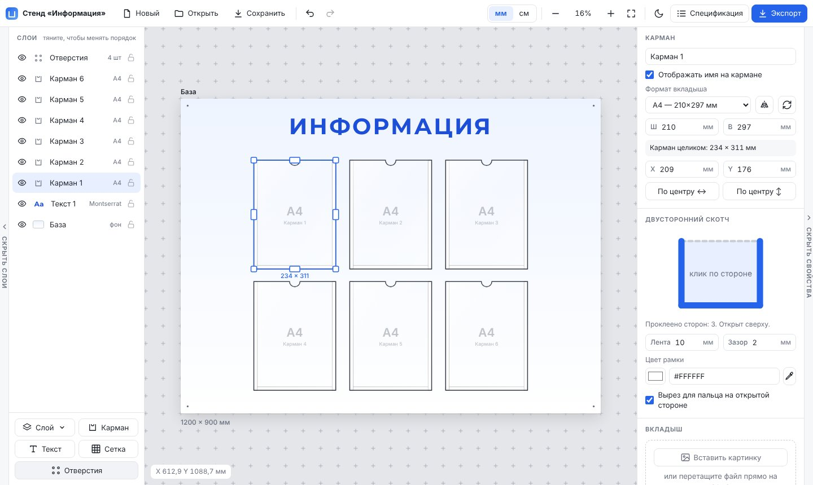
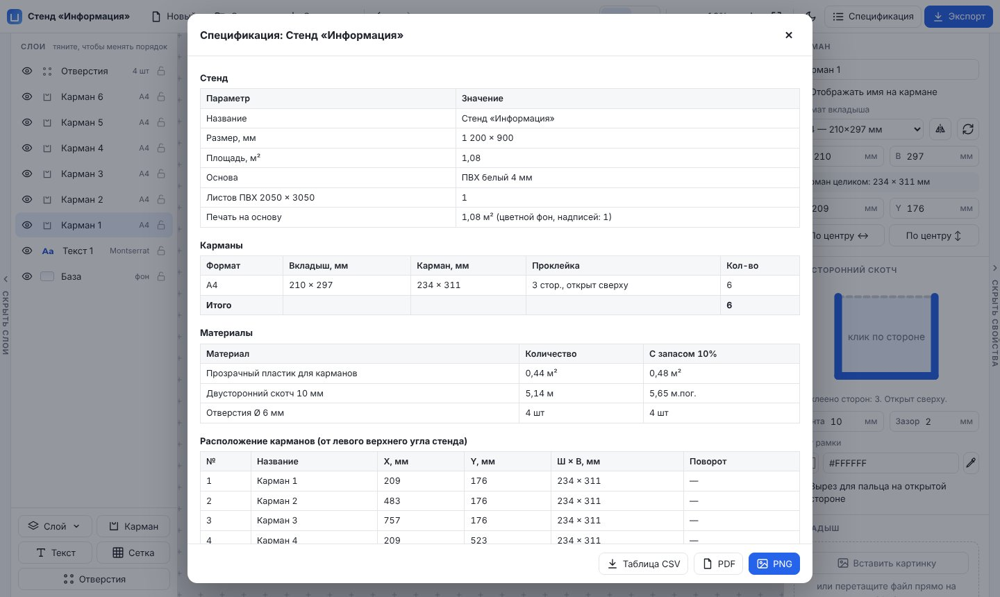
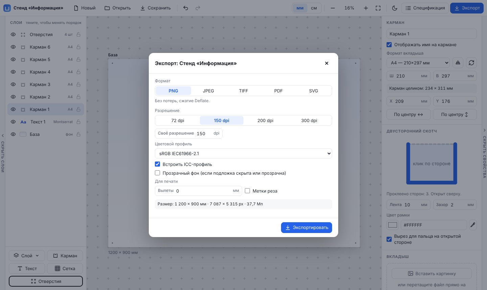

<p align="center">
  
</p>

<h1 align="center">ASMaker</h1>

<p align="center">
  <strong>Конструктор рекламных стендов с карманами прямо в браузере.</strong><br>
  Подложка из ПВХ, прозрачные карманы на двустороннем скотче, надписи кириллическими шрифтами, смета материалов и экспорт для типографии.
</p>

<p align="center">
  <a href="https://inikonoff.github.io/ASMaker/"><b>Открыть конструктор →</b></a>
</p>



## Зачем он нужен

Информационный стенд — это лист белого ПВХ 4–5 мм, на который наклеены прозрачные карманы. Каждый карман проклеен толстым двусторонним скотчем по трём сторонам, четвёртая остаётся открытой, чтобы вставлять листы. ASMaker помогает быстро собрать такой стенд, показать заказчику, как он будет выглядеть, и сразу посчитать, сколько уйдёт материалов.

Ничего не нужно устанавливать и регистрироваться не надо: всё работает в браузере, проект сохраняется на вашем устройстве.

## Возможности

**Подложка**
- Размер в миллиметрах или сантиметрах, готовые форматы, поворот книжная ↔ альбомная.
- Толщина ПВХ 4 или 5 мм. Если стенд больше стандартного листа 2050 × 3050 мм, появится предупреждение.
- Подложка — белый лист ПВХ; фон, градиенты и картинки кладутся слоями поверх. Всё, что выходит за край листа, на холсте не видно.

**Карманы**
- Форматы вкладыша: А3, А4, А5, А6, Евро ⅓ А4, фото 10×15, 15×21, 20×30 или свой размер.
- Размер кармана считается сам: вкладыш, плюс скотч на проклеенных сторонах, плюс зазор.
- Проклеенные стороны выбираются кликом по схеме. Выемка под палец на открытой стороне: полукруглая по центру или скошенный уголок (по умолчанию 20 × 20 мм) слева или справа.
- Ширина ленты, ширина цветной самоклейки по периметру (для спецификации), цвет рамки, картинка-вкладыш для наглядности.
- Поворот на 90°, отражение и «массив» N × M одной кнопкой.
- Предупреждения: карман вышел за край, пересекается с другим, на него попало отверстие.

**Текст**
- 12 встроенных шрифтов с кириллицей (включая белорусские «ў» и «і»): Inter, Roboto, Montserrat, PT Sans, PT Serif, Playfair Display, Oswald, Rubik, Comfortaa, Lobster, Caveat, Russo One.
- Можно добавить свои шрифты (TTF, OTF, WOFF, WOFF2), сразу несколькими файлами. Файлы одного семейства (Regular, Bold, Light, Italic…) объединяются по данным из самого шрифта, variable-шрифты получают все насыщенности. Шрифты сохраняются на устройстве и попадают в файл проекта.
- Насыщенность, курсив, подчёркивание, зачёркивание, прописные, наклон, интервалы, обводка, перенос строк по ширине.

**Слои и разметка**
- Слои «Заливка», «Градиент» и «Пустой» (для своей картинки) с поворотом и отражением.
- Панель слоёв как в Photoshop: порядок перетаскиванием, видимость, блокировка, переименование, прозрачность.
- Сетка в верхней панели (клавиша G): шаг, цвет, привязка, показ в экспорте.
- Отверстия под крепёж — в свойствах подложки, Ø 6 мм. Сначала 4 по углам, дальше пары по очереди на длинные и короткие стороны.

**Составной стенд**
- Линию раздела добавляют в свойствах подложки («Добавить линию») или правой кнопкой по стенду. Её тянут мышью, поворачивают на 90° и убирают кнопками у края подложки, точное положение задаётся в свойствах. «По листам ПВХ» сам делит стенд так, чтобы каждая часть влезала на лист 2050 × 3050 мм.
- Линии делят подложку и всё, что на ней. У каждой части свой набор отверстий, размеры частей видны на холсте. Карман на линии раздела получает предупреждение.
- Экспорт выдаёт каждую часть отдельным файлом с белым полем по периметру: по умолчанию 50 мм, меняется в свойствах подложки. Все файлы приходят одним ZIP.
- В спецификации есть таблица частей, а листы, отверстия и площадь печати с белым полем считаются по частям.

**Работа с элементами**
- Выделение рамкой, `Shift` + клик, диапазон в списке слоёв.
- Выравнивание по выделению или по стенду, «Расставить сеткой» с зазором между элементами или отступом от краёв.
- Умные направляющие и привязка к краям и центрам.
- Отмена и повтор, автосохранение, светлая и тёмная тема с регулировкой, скрываемые и растягиваемые панели.

## Спецификация и смета



Кнопка **«Спецификация»** собирает всё, что нужно для производства:

- размер и площадь стенда, сколько листов ПВХ потребуется, площадь печати;
- карманы по форматам и способу проклейки;
- материалы: м² прозрачного пластика, метры скотча по каждой ширине ленты, цветная самоклейка по периметру карманов (метры и м²), отверстия;
- координаты каждого кармана и центров отверстий от левого верхнего угла;
- список надписей со шрифтами и размерами;
- **смета**: цены за единицу (м², м.пог., лист, шт…), запас на отходы в процентах, свои позиции вроде монтажа или доставки, итог.

Выгружается в **CSV** (открывается в Excel и Google Таблицах), **PDF** (A4) или **PNG**. Цены запоминаются на устройстве и подставляются в следующие проекты.

## Экспорт



| Формат | Для чего | Особенности |
| --- | --- | --- |
| **TIFF** | типография | без сжатия или Deflate; RGB, RGBA, оттенки серого, CMYK; DPI и ICC в файле |
| **PDF** | типография, отправка | страница в размер стенда, TrimBox и BleedBox, изображение без потерь |
| **PNG** | веб, презентации | без потерь, прозрачность, ICC и DPI |
| **JPEG** | показать заказчику | маленький файл, качество настраивается |
| **SVG** | дальнейшая работа в редакторе | вектор в миллиметрах, шрифты и картинки встроены |

- Разрешение 72–1200 dpi; сразу видно размер в пикселях и вес файла.
- Цветовые профили: sRGB IEC61966-2.1, Adobe RGB (1998) с пересчётом цветов, оттенки серого (гамма 2.2), CMYK.
- Вылеты в миллиметрах и метки реза.

> **CMYK** переводится простой формулой, без ICC-профиля типографии. Для точного цвета отдавайте в печать Adobe RGB или sRGB: типография переведёт файл под свою машину и материал.

> PNG, TIFF и PDF собираются полосами, поэтому 300 dpi проходят и для больших стендов (ширина картинки — до 32 000 px, это около 2,7 м при 300 dpi). JPEG собирается целиком и ограничен ~150 Мп.

### Панель свойств

Свойства разложены по вкладкам: «Вид», «Оформление» (у текста), «Размер», «Цех». Частые действия — на панели над выделенным элементом. Если выделить несколько карманов или текстов, общие свойства меняются у всех сразу.

### Наполнение карманов, плашки, разделители

- **Наполнение** — в свойствах кармана: схема вложенного листа (текст, текст с картинками, две колонки, список, афиша, фото). Подстраивается под размер вкладыша.
- **Плашка заголовка** — «Элемент» → «Плашка заголовка» или раздел «Плашка» у любого текста. Готовые стили и донастройка формы, рамки, орнамента.
- **Разделитель** — «Элемент» → «Разделитель».

### Изделия на стенд

Кнопка «Элемент» в панели слоёв: перекидная система, карманы для буклетов и визиток, книга замечаний и предложений, ячейка для записок, магнитно-маркерная доска. Они видны на макете, идут в спецификацию строкой с пустой ценой (вписывают от руки) и на чертёж для цеха с номерами Э1, Э2…

### Для цеха

- **«Что экспортировать» → «Основа для печати»** — только печать на ПВХ, без карманов. С галочкой «Печатать метки на основе» на ней появляются Г-образные уголки под карманы (у кармана с вырезом в углу — три) и крестики центров отверстий.
- **«Чертёж для цеха»** (в окне спецификации) — PDF A4: лист с размерами, отступами и зазорами, номерами карманов и отверстиями; дальше — таблицы координат и спецификация.
- **«Пакет для цеха»** (в окне экспорта) — ZIP: основа для печати по частям и чертёж.
- DXF для резки — позже, после разговора с цехом.

## Проект

- **«Мои проекты»** (`Ctrl+Shift+O`): все стенды хранятся в браузере с превью и датой правки, каждый сохраняется сам. Из библиотеки их открывают, ищут по названию, дублируют и удаляют. «Новый» начинает следующий проект, а прежний остаётся в библиотеке.
- **«Сохранить»** (`Ctrl+S`) записывает файл `Название.stand.json`, в котором есть всё: картинки, свои шрифты и цены. В Chrome и Edge первое сохранение спрашивает место, а дальше `Ctrl+S` перезаписывает тот же файл, без «(1)», «(2)». «Сохранить как» — `Ctrl+Shift+S`. В других браузерах файл скачивается.
- **«Открыть»** (`Ctrl+O`) или перетаскивание файла на холст добавляет проект в библиотеку. Файл помнит свой проект, поэтому повторное открытие обновляет его, а не плодит копии. Если в библиотеке версия новее файла, файл откроется отдельной копией.
- Название проекта меняется кликом по нему в левом верхнем углу; так называются и все выгружаемые файлы.

## Google Диск и совместная работа

- **Вход через Google** — кнопка «Войти» справа вверху. Необязателен: без входа всё хранится в браузере.
- **Личные проекты** сами сохраняются в папку `ASMaker` на вашем Диске и появляются на других ваших устройствах. Значок на карточке показывает состояние: ☁ сохранён, ⟳ ждёт отправки, ☁↓ на Диске новее, ⚠ изменён в двух местах (выберите версию).
- **«Поделиться»** создаёт общую копию проекта и приглашает соавтора по email: редактор или читатель. Личный проект и общая копия правятся отдельно; между ними — «Забрать себе» и «Отправить мою версию в общую».
- **По очереди:** пока один редактирует, у остальных просмотр с автообновлением. «Закончить работу» освобождает проект; если редактор пропал, через 5 минут появится «Взять в работу».
- Приглашает и меняет роли только владелец. Владелец удаляет общий проект для всех, участник может выйти из него.

### Настройка Google-проекта (для своей копии)

Ключи лежат в `GOOGLE` в начале модуля облака в `src/app.html`; они публичные.
1. Google Cloud → новый проект → включить **Google Drive API** и **Google Picker API**.
2. Google Auth Platform → Branding (главная страница, `privacy.html`, домен сайта) → Data Access: `openid`, `email`, `profile`, `drive.file` → Audience: External, Publish.
3. Clients → Web application, Authorized JavaScript origins — адрес сайта.
4. Credentials → API key: ограничить адресом сайта и Google Picker API.
5. В `GOOGLE` указать `clientId`, `apiKey`, `appId` (номер проекта) и `appUrl`.

Политика конфиденциальности: [privacy.html](https://inikonoff.github.io/ASMaker/privacy.html). История изменений: [CHANGELOG.md](CHANGELOG.md).

## Горячие клавиши

| Клавиши | Действие |
| --- | --- |
| Колесо мыши | масштаб вокруг курсора |
| `Alt` + колесо | точный масштаб с шагом 1% |
| `Пробел` + мышь, средняя кнопка или протяжка правой | двигать холст |
| `0` / `1` | показать стенд целиком / реальный размер |
| `Ctrl+Z` / `Ctrl+Shift+Z` | отменить / повторить |
| `Ctrl+D` | дублировать |
| `Ctrl+C` / `Ctrl+X` / `Ctrl+V` | копировать / вырезать / вставить (работает и между вкладками) |
| `Ctrl` или `Alt` + перетаскивание | быстрый дубликат |
| `Ctrl+A` | выделить все элементы |
| `Delete` | удалить |
| Стрелки (`Shift` — по 10 мм) | сдвиг на 1 мм |
| `R` / `Shift+R` | повернуть на 90° по / против часовой |
| `Shift+H` | отразить по горизонтали |
| `Ctrl` при перетаскивании | без привязки (при дубликате — `Ctrl+Shift`) |
| Двойной клик по тексту | редактировать |
| Двойной клик по ползунку | значение по умолчанию |
| `Ctrl+S` / `Ctrl+Shift+S` | сохранить в файл / сохранить как |
| `Ctrl+O` / `Ctrl+Shift+O` | открыть файл / мои проекты |
| `G` | сетка вкл/выкл |
| `D` | размеры и расстояния вкл/выкл |
| `V` | вид: производство / клиент |
| `Ctrl+G` / `Ctrl+Shift+G` | сгруппировать / разгруппировать |
| Правая кнопка | клик — меню действий, протяжка — двигать холст |
| `Ctrl+Alt+C` / `Ctrl+Alt+V` | копировать / вставить стиль |
| `Ctrl+Shift+E` | экспорт |

## Запуск у себя

Готовый конструктор — один файл `index.html` без зависимостей. Шрифты в него уже встроены, поэтому он работает и без интернета: скачайте файл и откройте двойным кликом.

### Сборка из исходников

Исходник страницы — `src/app.html`. Шрифты в него вставляет скрипт сборки (нужны Python 3 и npm):

```bash
python3 tools/build.py
```

Скрипт скачает пакеты шрифтов [Fontsource](https://fontsource.org/) в `build/` и соберёт `index.html` в корне.

### Структура

```
index.html              готовая страница (собрана из src/app.html)
src/app.html            исходник: HTML, CSS и JavaScript в одном файле
tools/build.py          встраивание шрифтов
og.jpg, favicon.svg,    превью для мессенджеров и иконки
apple-touch-icon.png
docs/                   скриншоты для README
```

## План развития

Что планируется дальше — в [TODO.md](TODO.md).

## Лицензии

Встроенные шрифты распространяются по лицензии [SIL Open Font License 1.1](https://openfontlicense.org/) и получены через пакеты Fontsource.
